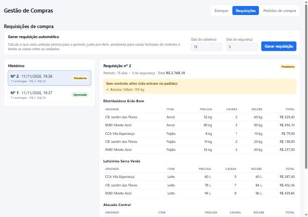

# Gestão de Compras

Sistema web para centralizar as compras de alimentos de várias unidades (escolas, centros de convivência etc.).
Ele calcula sozinho quanto cada unidade precisa comprar, junta tudo por item, respeita as **caixas fechadas**
do contrato com o fornecedor, divide as caixas entre as unidades e, na aprovação, gera **um pedido de compra por
fornecedor** em PDF.

> Projeto de portfólio com dados fictícios, inspirado em problemas reais de compras em rede de unidades.



## Stack

| Camada | Tecnologias |
|---|---|
| Backend | Java 17, Spring Boot 3.5 (Web, Data JPA, Validation), Hibernate |
| Banco | H2 em memória (padrão) ou MySQL 8 (perfil `mysql`) |
| PDF | OpenPDF |
| Frontend | React 19, TypeScript, Vite |
| Testes | JUnit 5, AssertJ, MockMvc |
| CI | GitHub Actions (testes do backend + build do frontend) |

## Regras de negócio

**1. Necessidade por unidade**

```
necessidade = consumo médio diário × (dias de cobertura + dias de segurança) − saldo atual
```

Nunca fica negativa e é arredondada para cima, para não faltar por arredondamento.
Código: [`CalculoNecessidade`](backend/src/main/java/br/com/gestaocompras/regras/CalculoNecessidade.java).

**2. Caixas fechadas e rateio entre unidades**

O fornecedor só vende caixas fechadas. Em vez de arredondar caixa por caixa em cada unidade (o que gera
sobra em todas), o sistema soma a necessidade de todas, compra o mínimo de caixas que cobre o total e divide
as caixas pelo **método do maior resto**:

1. Total de caixas = necessidade somada ÷ tamanho da caixa, arredondado para cima.
2. Cada unidade recebe a parte inteira da sua cota proporcional.
3. As caixas que sobram vão para as unidades com a maior parte fracionária. No empate, vence quem precisa de
   mais e, depois, a ordem da lista, para o resultado ser sempre o mesmo.

Exemplo (arroz, caixa de 30 kg): as unidades precisam de 52, 9 e 80 kg → 141 kg → **5 caixas** →
cotas 1,84 / 0,32 / 2,84 → **2, 0 e 3 caixas**.
Código: [`RateioCaixas`](backend/src/main/java/br/com/gestaocompras/regras/RateioCaixas.java).

> Consequência conhecida: uma unidade com necessidade pequena pode ficar sem caixa naquele ciclo (no exemplo,
> a que precisa de 9 kg). A necessidade dela continua no estoque e entra no próximo cálculo.

**3. Itens sem contrato**

O que falta, mas não tem contrato ativo, não entra no pedido. Aparece num aviso na requisição para o
comprador tratar.

**4. Aprovação**

* Só uma requisição **pendente** pode ser aprovada ou reprovada. Decidir de novo devolve HTTP 409.
* Reprovar exige motivo.
* Aprovar gera um pedido por fornecedor. Preço e tamanho da caixa são **copiados** para o pedido, para que uma
  mudança futura no contrato não altere um pedido já enviado.

## Como rodar

Pré-requisitos: Java 17+, Maven e Node 20+.

```bash
# backend: http://localhost:8080 (sobe com dados de exemplo)
cd backend
mvn spring-boot:run

# frontend: http://localhost:5173 (em outro terminal)
cd frontend
npm install
npm run dev
```

Se a porta 8080 estiver ocupada, suba o backend em outra porta e avise o frontend:

```bash
mvn spring-boot:run -Dspring-boot.run.arguments=--server.port=8081
API_URL=http://localhost:8081 npm run dev
```

### Com MySQL

As credenciais vêm de variáveis de ambiente; nenhuma senha fica no código.

```bash
export DB_URL="jdbc:mysql://localhost:3306/gestao_compras?createDatabaseIfNotExist=true"
export DB_USER="root"
export DB_PASSWORD="sua-senha"
mvn spring-boot:run -Dspring-boot.run.profiles=mysql
```

### Testes

```bash
cd backend
mvn test
```

São 19 testes: as regras de cálculo e rateio (incluindo um teste de propriedade com 500 casos aleatórios
que confere que o rateio sempre soma o total de caixas) e o fluxo completo pela API.

## API

| Método | Rota | Descrição |
|---|---|---|
| GET | `/api/estoques` | Saldo, consumo e dias de cobertura por unidade e item |
| GET | `/api/contratos` | Contratos com preço e tamanho da caixa |
| GET | `/api/unidades`, `/api/fornecedores` | Cadastros |
| POST | `/api/requisicoes` | Gera a requisição automática. Corpo: `{"diasCobertura": 15, "diasSeguranca": 3}` |
| GET | `/api/requisicoes`, `/api/requisicoes/{id}` | Histórico e detalhe |
| POST | `/api/requisicoes/{id}/aprovar` | Aprova e gera os pedidos por fornecedor |
| POST | `/api/requisicoes/{id}/reprovar` | Reprova. Corpo: `{"motivo": "..."}` |
| GET | `/api/pedidos`, `/api/pedidos/{id}` | Pedidos de compra |
| GET | `/api/pedidos/{id}/pdf` | PDF do pedido para o fornecedor |

Os erros seguem o padrão [Problem Details (RFC 9457)](https://www.rfc-editor.org/rfc/rfc9457), com a mensagem
em `detail`.

## Estrutura

```
backend/src/main/java/br/com/gestaocompras
├── dominio/      entidades JPA e regras de estado (ex.: só pendente pode ser aprovada)
├── regras/       cálculos puros, sem banco: necessidade e rateio de caixas
├── servico/      casos de uso: gerar, aprovar, reprovar, PDF
├── repositorio/  Spring Data JPA
├── api/          DTOs de entrada e saída (as entidades não são expostas)
├── web/          controllers REST e tratamento de erros
└── config/       relógio injetável e dados de exemplo
frontend/src
├── telas/        Estoque, Requisições e Pedidos
├── api.ts        tipos e chamadas da API
└── estilos.css   tema claro e escuro automático
```

## Próximos passos

- Login com perfis (comprador, gerente) usando Spring Security
- Cotação entre fornecedores antes de gerar o pedido
- Registro de recebimento com conferência da nota fiscal
- Docker Compose com MySQL

## Autor

Gabriel Araujo de Sousa · [LinkedIn](https://www.linkedin.com/in/gabriel-araujo-sousa-dev)
